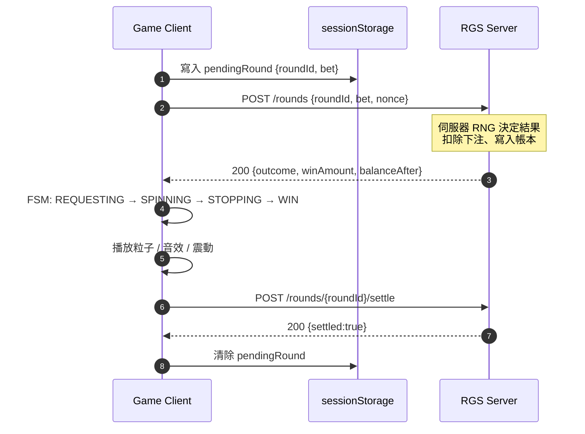
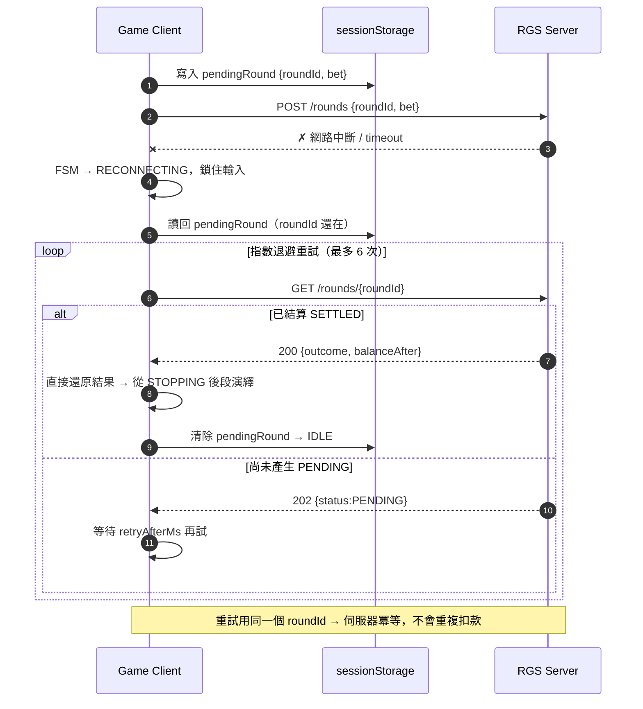
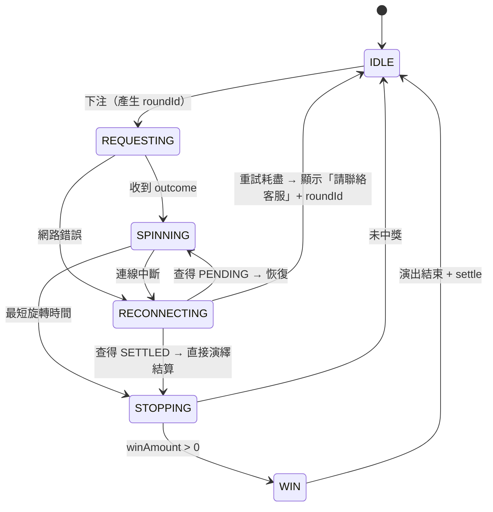

# RGS 串接規格（老虎機 · 前後端分離 / 斷線重連）

> 核心原則：**結果永遠由伺服器 RNG 決定，前端只是視覺演繹層。**
> 前端不得持有賠率表、不得自行產生結果、不得以本地餘額為準（本地餘額僅供顯示）。

---

## 1. 名詞與 ID 設計

| 欄位 | 說明 | 由誰產生 |
|---|---|---|
| `roundId` | 單局唯一識別，**冪等鍵（idempotency key）**。格式 UUID v4 或 `timestamp-seq` | 前端（下注前先 generating，寫入 sessionStorage） |
| `betId` | 單次下注識別；若一局含多注（如 Turbo），用 `roundId:betIndex` | 前端 |
| `nonce` | 前端隨機數，參與 provably-fair 的 client seed | 前端 |
| `serverSeedHash` | 伺服器種子雜湊，開局前公開，结算後揭露 `serverSeed` 供驗證 | 伺服器 |
| `signature` | 回傳資料簽章，防止傳輸途中被竄改（**不代表結果可信**，信任根在伺服器） | 伺服器 |

> ⚠️ `roundId` 必須在**發請求前**就產生並持久化。否則斷線後前端不知道要向誰查結果，會造成「玩家下了注但畫面沒中獎」的客訴。

---

## 2. API 端點

### 2.1 建立遊戲局（下注 + 結果一次回傳）

```
POST /api/v1/rounds
Content-Type: application/json
Authorization: Bearer <sessionToken>
Idempotency-Key: <roundId>

Request
{
  "roundId": "9f1c...-4a2b",
  "betAmount": 10,
  "currency": "TWD",
  "nonce": "a8d3f1"
}

Response 200
{
  "roundId": "9f1c...-4a2b",
  "status": "SETTLED",
  "outcome": {
    "reels": [5, 5, 2],          // 符號索引（由伺服器 RNG 決定）
    "paylines": [{ "line": 1, "symbol": 5, "payout": 1000 }],
    "winAmount": 1000
  },
  "balanceAfter": 1990,
  "serverSeedHash": "b2c1...",
  "signature": "3045..."
}
```

伺服器對同一個 `roundId` 重複請求 → **回傳同一份結果**，不重复扣款（冪等）。

### 2.2 斷線重連查局

```
GET /api/v1/rounds/{roundId}
Authorization: Bearer <sessionToken>

Response 200（已結算）
{ "roundId": "...", "status": "SETTLED", "outcome": {...}, "balanceAfter": 1990 }

Response 202（尚在處理，前端繼續輪詢）
{ "roundId": "...", "status": "PENDING", "retryAfterMs": 800 }
```

### 2.3 確認結算（可選，用於財務對帳）

```
POST /api/v1/rounds/{roundId}/settle
→ { "roundId": "...", "settled": true, "balanceAfter": 1990 }
```

---

## 3. 時序圖（正常流程）



---

## 4. 時序圖（斷線重連）



---

## 5. 前端狀態機（含重連）



---

## 6. 前端 Adapter（可直接整合）

完整可跑版本見 `rgs-client-demo.html`。核心程式碼：

```js
class RGSClient {
  constructor({ baseUrl, getToken, onStateChange }) {
    this.base = baseUrl;
    this.getToken = getToken;
    this.onState = onStateChange;
  }

  // 串接點：所有請求都帶 roundId，RGS 保證冪等
  async _post(path, body, signal) {
    const res = await fetch(this.base + path, {
      method: "POST",
      signal,
      headers: {
        "Content-Type": "application/json",
        "Authorization": `Bearer ${this.getToken()}`,
        "Idempotency-Key": body.roundId || ""
      },
      body: JSON.stringify(body)
    });
    if (!res.ok) throw new Error("HTTP_" + res.status);
    return res.json();
  }

  async play(betAmount) {
    const roundId = crypto.randomUUID();        // 下注前先產生
    const nonce = crypto.randomUUID().slice(0, 8);
    sessionStorage.setItem("pendingRound", JSON.stringify({ roundId, betAmount, ts: Date.now() }));

    try {
      const data = await this._post("/api/v1/rounds", { roundId, betAmount, nonce });
      return this._finalize(data);
    } catch (e) {
      this.onState("RECONNECTING");
      return this.resume(roundId);              // 進入重連流程
    }
  }

  async resume(roundId) {
    const delays = [300, 600, 1200, 2400, 4800, 8000]; // 指數退避 + 抖動
    for (const d of delays) {
      await this._sleep(d + Math.random() * 200);
      try {
        const res = await fetch(`${this.base}/api/v1/rounds/${roundId}`, {
          headers: { "Authorization": `Bearer ${this.getToken()}` }
        });
        if (res.status === 202) continue;        // PENDING，繼續輪詢
        if (!res.ok) continue;
        const data = await res.json();
        if (data.status === "SETTLED") return this._finalize(data);
      } catch (_) { /* 保持重試 */ }
    }
    throw new Error("RECONNECT_FAILED:" + roundId); // UI 顯示 roundId 供客服查詢
  }

  _finalize(data) {
    sessionStorage.removeItem("pendingRound");
    this._post(`/api/v1/rounds/${data.roundId}/settle`, { roundId: data.roundId })
      .catch(() => {});                         // settle 失敗不阻塞演出，由伺服器補帳
    return data;                                // 前端只拿 outcome 做視覺演繹
  }

  // 頁面載入時檢查是否有未完成的局（例如使用者關掉分頁又打開）
  bootstrap() {
    const p = JSON.parse(sessionStorage.getItem("pendingRound") || "null");
    return p ? this.resume(p.roundId) : null;
  }

  _sleep(ms) { return new Promise(r => setTimeout(r, ms)); }
}
```

---

## 7. 上線注意事項（博弈合規 / 防作弊）

1. **信任邊界**：前端的 `balance` 只是快取顯示，每次操作後以 `balanceAfter` 覆寫。切勿用本地加減決定可否下注（下注合法性由 RGS 檢查）。
2. **防連點**：`roundId` 在 `IDLE` 之外不得產生；按鈕 disabled + FSM 雙重鎖。
3. **結果不可预测的呈現**：收到 outcome 後再播「期待感」動畫；不要在請求前就先停輪或預告結果。
4. **Provably Fair**：开局前顯示 `serverSeedHash`，玩家可保存；结算後揭露 `serverSeed` + `nonce` 供驗證。前端只做雜湊比對展示，不參與 RNG。
5. **日誌**：所有 `roundId`、`betAmount`、`winAmount` 要寫入可查帳的日誌，供爭議處理（GLI / 監管要求）。
6. **敏感資料**：`sessionToken` 用 HttpOnly Cookie 或短期 JWT；不要把 balance / winAmount 放進 URL。
7. **重連極限**：重試耗盡時不要自動重下注，應顯示 `roundId` 並引導客服；避免「玩家以為沒中，其實已中」的糾紛。
